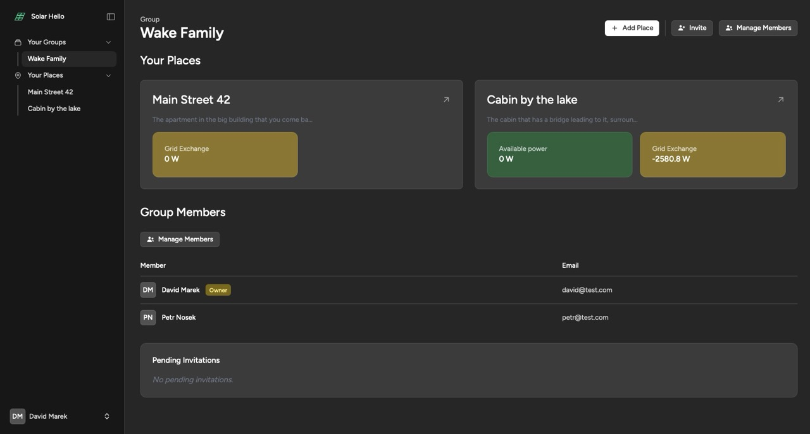
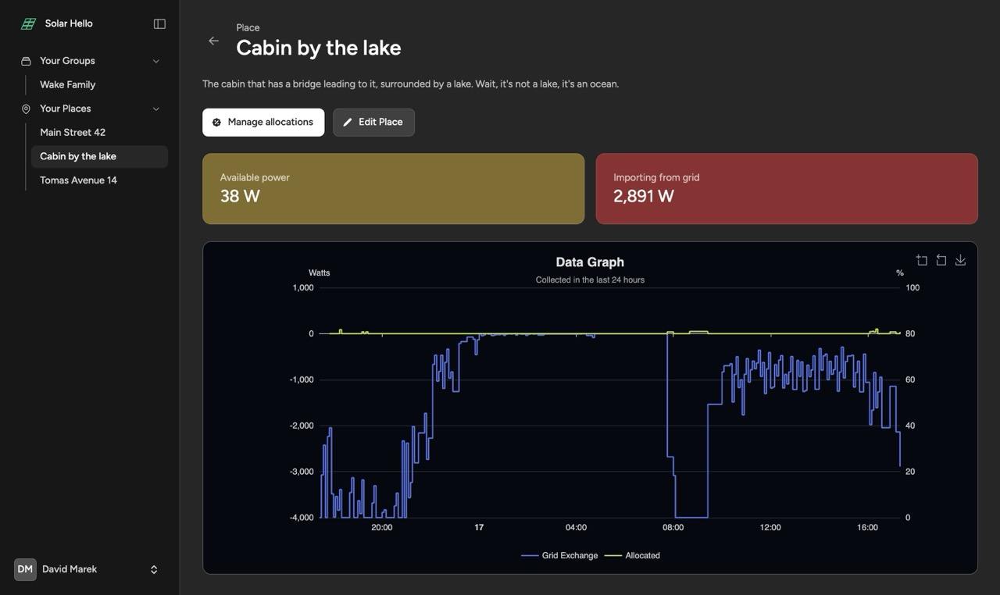
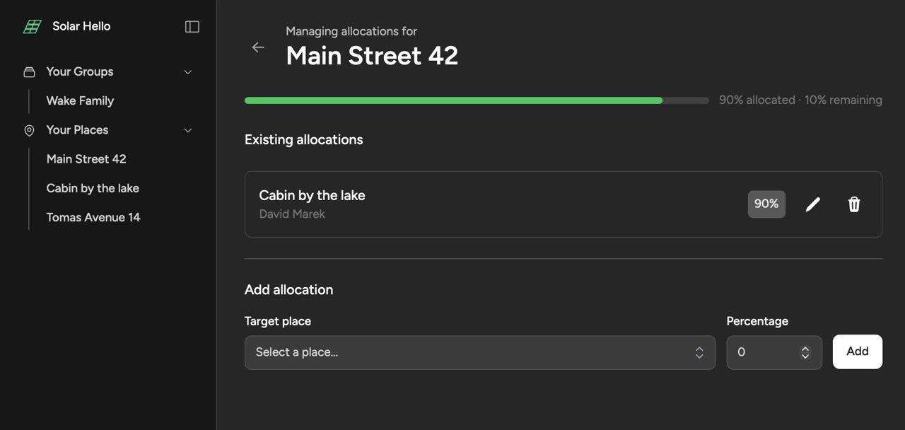
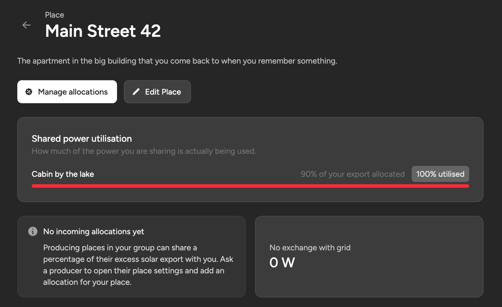

# Solar Hello

A Laravel + Livewire application for managing solar energy production across groups, places, and integrations. Users create groups, add places (e.g. homes, sites), connect solar provider integrations (Solax, Shelly), and allocate available power between members.


## Tech Stack

- PHP 8.3
- Laravel 13
- Livewire 4 + Flux UI
- Laravel Fortify (authentication)
- Tailwind CSS 4 + Vite
- SQLite (default)
- Bun (for the JS toolchain)
- Laravel Telescope (local debugging)

## Requirements

- PHP 8.3+
- Composer
- Bun (or Node.js, if you swap the scripts)
- [Laravel Herd](https://herd.laravel.com/) is used to serve the site locally at `http://solar-hello.test`. If you do not use Herd, run `php artisan serve` instead.

## Installation

```bash
composer install
cp .env.example .env
php artisan key:generate
php artisan migrate
php artisan solar:sync-providers

bun install
bun run build
```

## Running the Project

The application has three moving parts that must all be running for it to work correctly:

1. **HTTP server** - serves the app (Herd handles this automatically, or use `php artisan serve`).
2. **Queue worker** - processes background jobs such as `SyncIntegrationJob` and `CalculateAvailablePowerJob`, which fetch data from solar providers and compute available power.
3. **Scheduler** - dispatches the `solar:sync` command every minute (defined in `routes/console.php`). Without the scheduler, integrations will never sync.

In separate terminals:

```bash
# 1. Vite dev server (hot reload for assets)
bun run dev

# 2. Queue worker (processes integration sync and power calculation jobs)
php artisan queue:work

# 3. Scheduler (dispatches solar:sync every minute)
php artisan schedule:work

# 4. HTTP server - skip this if Herd serves the site
php artisan serve
```

> Note: `composer dev` runs `queue:listen` but does **not** run the scheduler. If you rely on `composer dev`, also start `php artisan schedule:work` in a separate terminal so integrations keep syncing.


## Screenshots

### Group dashboard
Overview of a group's places, live grid exchange and available power, members, and pending invitations.



### Consumer place
A consumer place with available power, grid import, and a 24h data graph of grid exchange vs. allocated power.



### Allocation management
Allocate a percentage of a producing place's excess export to other places in the group.



### Producer place (shared power utilisation)
A producing place showing how much of its shared export is actually being used by recipients.




## Seeded Test Users

**Test User - David**
- Email: `david@test.com`
- Password: `password`
- Has a production and a consumer place (both with integration)


**Test User - Petr**
- Email: `petr@test.com`
- Password: `password`
- Has a consumer place (without integration)


## Useful Commands

- `php artisan solar:sync` - dispatch sync jobs for all active pull-based integrations
- `php artisan solar:sync-providers` - sync registered solar providers into the `integration_providers` table (run after each deploy)
- `php artisan telescope` - open Telescope at `/telescope` for debugging
- `vendor/bin/pint --dirty` - format changed PHP files
